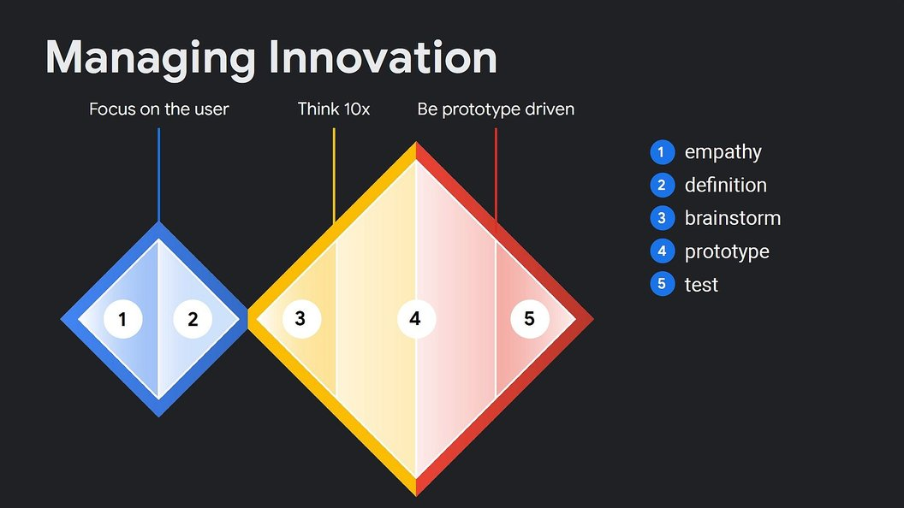

# Architecting and Building the Agentic Marketing System

*Foundational Architecture and Workflows for AI-Assisted Marketing Systems*

*Current as of 2026-11-04. First written April 2026; scores, commandments and external references were re-checked against six months of practitioner evidence on 2026-11-04 (see [CHANGELOG v2.3](CHANGELOG.md) and the dated evidence in [research/2026-11-04-six-month-revalidation.md](research/2026-11-04-six-month-revalidation.md)). Next scheduled check: April 2027.*

> **How to use this document.** Section 1 is the poster - print it, pin it, re-read it before every marketing engagement. Sections 2-3 are the skeleton and the scored inventory - the catalyst you bring to business users so they never face a blank page. The **Size Fit** column in Section 3 and the **Sourcing Cheat Sheet** in Section 3.10 tell you which rows are essential, helpful, or skippable at your scale - whether you are a solo consultant or a global enterprise. Sections 4-5 are the execution model and the non-functional defense. Section 6 lists what was considered and trimmed. Section 7 is a short reflection on how this distillation was made.
>
> **For readers at every size.** This document is intentionally written to be useful from a solo real-estate broker running their own SEO to a global brand with a four-tier marketing organization. See [Marketing-Vendors-By-Category.md](research/Marketing-Vendors-By-Category.md) for the living vendor and tool companion.

---

## 1. The 7 Commandments

The principles I hold when I walk into any marketing client engagement. Every commandment is a reaction to a real failure mode I've seen or read about - none of them are aspirational.

1. **Empathy before architecture.** Phase 3 (architecture) fails when Phases 1 and 2 (empathy and definition) are skipped. If a stakeholder asks for architecture on day one, my job is to earn the right to answer by doing discovery first - not to draw boxes I'll regret.

2. **Catalyst, not blank page.** Business users don't say "here are my requirements" - they say "show me what you have, and I'll tell you what I want." Always arrive with working sample skills from industry creators (Kieran Flanagan, Rick Mulready, Grace Leung) as ideation catalysts. The blank page is the enemy; a flawed template is a friend.

3. **Co-Create - don't ping-pong.** English is the new programming language, so the business owns the logic in plain text. I own the governance wrapper: API connections, deterministic linters, identity resolution, evaluations. The waterfall-era handoff is gone; what replaces it is a two-lane highway, not a conveyor belt.

4. **Decouple logic from platform: portable by design, proven by a run on a second harness.** The Agentic Skill (plus MCP for connectivity) is the portable unit, and the open Agent Skills standard now runs on more than seventy platforms. Portability is still a practice, not a property of the file format: moving a real setup between two agent hosts means translating the instruction file, converting sub-agent formats and reconnecting every tool, and the two hosts do not share memory. So the rule is: keep context, instructions and skills in plain exportable files, and do not call a skill portable until it has run on a second platform. Vendor lock-in is a tax on tomorrow's flexibility; untested portability is a promise you cannot keep. *(Reworded 2026-11-04; the April text promised "total portability without rewriting a line", which the cited practitioners' own migrations contradict.)*

5. **Augment, don't replace: agents act within explicit authority and budgets; a human approves what cannot be undone.** Agents produce drafts and run reversible work on their own. Anything irreversible or money-moving (a send, a publish, a payment, a deletion) gets a human gate, and the gate is a control (least privilege, a deterministic check), never only an instruction in the prompt, because instructions get lost when context is compacted. The goal is bigger LEGO pieces for people to inspect, not a dehumanized pipeline and not a human rubber-stamping four hundred approvals a day. *(Reworded 2026-11-04; the April text said humans approve "anything that changes state", and every team running agents at volume reports that per-action approval decays into rubber-stamping.)*

6. **Default-deny MCP writes.** Model Context Protocol servers are read-only by default. Write access requires a granular permission model, explicit authorization, and testing. Each agent gets its own identity and short-lived, scoped credentials, never a person's login. A hallucinating agent that can only propose drafts is a feature; a hallucinating agent that can publish or delete is a liability.

7. **Observability is Day 1, not Day 2, and limits ship with it.** Non-deterministic tool use and self-updating memory require telemetry from the moment a skill ships: traces, evals, an audit log the agent cannot reach, and drift checks as models change underneath you. Observability tells you what happened; limits bound what can happen: a spend cap, a turn limit and a wall-clock limit on every scheduled run, and a sandbox by default. Prefer platforms that provide these natively, and verify that they work for your workflow; native packaging is not the acceptance test. *(Reworded 2026-11-04; the April text named specific platforms and said "pick a different platform" if guardrails were not built in.)*

---

## 2. The Marketing X-Ray: 8 Universal Verbs

The bones. These eight activities recur across most marketing organizations, regardless of B2B/B2C, product category, or whether AI exists. Think of them as the axioms - the "addition, subtraction, multiplication, division" of the discipline - that underlie every specific use case in Section 3.

Every activity in this document serves the same underlying sequence: prospects must first become **aware** you exist, then develop **affinity** for what you stand for, then build enough **trust** to transact. A one-person consultancy and a global corporation run the same chain; only the instrumentation, budget, and governance change. The 8 verbs below are the cycle that moves prospects through awareness → affinity → trust → transaction at any scale.

Since late 2026 the chain has a second reader. Shopping agents that compare and buy on a person's behalf have shipped in limited form, and an agent is not moved by affinity: it is moved by proof, prices and policies it can read. The human chain above still describes the buyer; the agent needs its own door (see the agent-readiness and agent-readable rows under SENSE and SHIP).

### 2.1 SENSE: Watch the water for signals

Every marketing cycle begins with monitoring what's moving in the market: trending topics, competitor launches, regulatory shifts, cultural moments, voice-of-customer complaints, analyst coverage, search query shifts. This is "Step Zero" - the fishing sonar that runs continuously in the background and feeds every downstream decision. The output is a rolling picture of what the market is paying attention to *right now*.

### 2.2 KNOW: Build and maintain audience intelligence

Separate from what's trending is *who you're selling to*. Every big marketing org maintains (or should maintain) persistent audience assets: ICPs for B2B, segments for B2C, personas, jobs-to-be-done, journey maps, brand-affinity profiles, emotional registers, vocabulary catalogs. Unlike Sense, which is continuous, Know is **infrastructure** - built once, reused across every campaign. In practice it has become a folder of plain files that every agent reads before it does anything: who the customer is, what the brand stands for, how it is positioned, what the goals are. Practitioners call it the context layer or the intelligence layer; Kieran Flanagan's version has a personal slot and a confidentiality rule (company data stays with the company, transferable learnings travel with the person). Know owns that folder.

The test that separates the two is still tempo and ownership, not topic: Sense answers "what changed this week," Know answers "who are we talking to, and what do they bite on." What changed in 2026 is the refresh: the files are now revised from evidence on every run (a voice-of-customer skill rewrites the ICP file each time it reads new calls), while the truth they describe still moves slowly. So Sense feeds Know continuously, and a human curates what sticks. Two things that look like Know but are not: verified facts about the market (a central-bank rate, a regulator's deadline, a published statistic) are Sense that has been checked against its primary source, and brand voice or compliance rules are Make's guardrails. *(Reworded 2026-11-04; the earlier text said "refresh quarterly, not continuously", which no longer matches practice.)*

### 2.3 DECIDE: Choose what to say, to whom, when, for how much

The strategic fulcrum. Position the brand, pick the message, ideate the campaign, approve the editorial/content calendar, allocate the budget across channels and time windows. The Performance-Driven Lookalike and Voice of Customer patterns live here because they replace guesswork with evidence. The editorial calendar is always a first-class artifact in this verb - it governs what ships when even when AI is never invoked.

### 2.4 MAKE: Produce the assets

Copy, video, imagery, landing pages, email bodies, decks, social creatives. This verb also quietly contains the ugliest recurring task in enterprise marketing: **compliance and legal review**. In regulated industries like financial services, healthcare, and pharma, the review pass is frequently longer than the creation pass. Brand voice enforcement and style-guide adherence also live here.

### 2.5 SHIP: Push to channels, on schedule, in the right language

The distribution layer: owned (website, email, app), earned (PR, organic social, influencer), paid (programmatic, social ads, search ads, broadcast). This is where the calendar becomes execution, where localization kicks in for global brands, and where lifecycle orchestration decides which customer sees what next. Ship is not an afterthought - distribution is often one of the largest budget buckets in mature marketing organizations.

### 2.6 MULTIPLY: Reshape and personalize what you already made

Repurposing is the single highest-ROI muscle in content marketing. A research report becomes 20 LinkedIn posts, 5 email sends, 3 webinars, 40 social cards, 1 keynote, 8 sales enablement slides. Dynamic personalization (CRO, landing page assembly, creative variation generation) also lives here. Multiply is where agentic AI shines brightest because the source material is already human-approved - the risk is low and the leverage is enormous.

### 2.7 MEASURE: Attribute, dashboard, analyze

How did each asset perform? What does the conversion funnel look like? Which segment responded? What are CAC, LTV, ROAS, incrementality? Which creative variant won the test? Much of this verb is **classic MarTech plumbing** (tags, pixels, data warehouses, attribution models) that is not AI-native work. AI shows up for reporting, summarization, and anomaly detection - not for the core measurement infrastructure.

### 2.8 LEARN: Close the loop, update the playbook

Retrospectives, post-mortems, documented learnings, updated persona files, evolved brand voice notes, new creative guidelines, revised targeting rules. This is where the Self-Optimizing Feedback Loop lives conceptually - but with the important caveat that **self-mutating production systems need human-curated checkpoints**, not autonomous 3 AM rewrites. Learn is where the organization gets smarter; it should not be where the organization loses control.

### 2.9 Mapping to Established Frameworks

These 8 verbs were derived from practice, not theory. For readers familiar with established marketing frameworks, here's how they map. Dashes mark where the established framework has no equivalent - those gaps are where the operational decomposition does its most useful work for agent design.

| Framework | SENSE | KNOW | DECIDE | MAKE | SHIP | MULTIPLY | MEASURE | LEARN |
| --- | --- | --- | --- | --- | --- | --- | --- | --- |
| Kotler (MR → STP → VP → MP → I → C) | Marketing Research | STP | Value Prop, Marketing Plan | - | Implementation | - | Control | - |
| SOSTAC (PR Smith, 1990s) | Situation | Situation | Objectives, Strategy | Tactics | Action | - | Control | Control → Situation feedback loop |
| RACE (Chaffey, 2010) | Plan | Plan | Plan | - | Reach, Act | Convert | - | Engage |
| 4Ps (McCarthy / Kotler) | - | - | Product, Price | Promotion (creative) | Place, Promotion (distribution) | - | - | - |

Three patterns worth noting. First, MAKE has no clean equivalent in any of the four frameworks. Kotler assumes production happens; SOSTAC files it under Tactics. But compliance review, brand voice enforcement, and creative production are where enterprise teams spend enormous time and where agent skills have the highest leverage. Second, the SENSE/KNOW split (continuous monitoring vs. persistent audience infrastructure) doesn't exist in any established framework, but it's essential for agent design because it separates "always running" skills from "quarterly refresh" skills. Third, MULTIPLY is absent from all four. CRO and repurposing exist as marketing concepts, but no framework treats "reshape what you already made" as a first-class activity. For agent design it matters because the input is already human-approved, which changes the risk profile entirely.

These frameworks answer different questions. Kotler asks "how do you plan marketing strategy?" SOSTAC asks "how do you structure a marketing plan?" RACE asks "what stages does the customer move through?" The 8 verbs ask "what does a marketer actually do, and which of those activities can an AI agent help with?" The mapping is provided for orientation, not equivalence.

### 2.10 Sizing the Reader

The scored inventory in Section 3 uses a **Size Fit** column so you can locate yourself on the spectrum and skip what doesn't apply at your scale.

| Tier | Headcount (rough) | Marketing profile | Default sourcing posture |
| --- | --- | --- | --- |
| **Solo (S)** | 1 — founder, broker, consultant, creator, personal brand | The marketer *is* the business owner. No MarTech budget. | DIY with GAI + free tools. Copy SaaS functionality with AI agents when the subscription costs more than your time. |
| **SMB** | 2–500 — local business, agency, regional brand, growing startup | One marketing hire to a small team. Some SaaS (HubSpot, Mailchimp, Canva). No dedicated MarTech ops. | Mix: AI augments the marketer, occasional freelancer for production peaks, buy cheap SaaS when it clearly beats DIY. |
| **Enterprise (E)** | 500+ — global, multi-region, regulated, complex stack | Dedicated teams per verb; full MarTech stack; legal, compliance, brand stewardship functions. | Buy incumbent SaaS, ride AI on top via MCP, keep humans in the loop for every state-changing action. |

These 3 buckets are deliberately coarse. The gap between a 50-person SMB and a 400-person "mid-market" company is real - but it is absorbed by the Universality % column in Section 3, which acts as a probabilistic slider within each tier. If you are mid-market, read yourself as "upper SMB" on low-AI-leverage rows and "lower Enterprise" on high-automation rows.

---

## 3. The Scored Inventory Table

The muscles. Every activity I can identify that maps to the 8 verbs above, scored on two axes:

- **Universality %** - how common is this activity across big marketing organizations? (100 = every big marketer does this, 0 = niche to one vertical or company)
- **AI Leverage %** - how much human effort an agent saves per *accepted* deliverable, counting the briefing, the verification and the rework, at a quality the owner would sign (100 = the human's share is a brief and a sign-off, 0 = the activity is inherently human). It is a measure of effort saved, not of revenue impact and not of whether you *should* automate the activity; see the copy-drafting rows for a case where capability and wisdom part ways.
- **Priority Score** = Universality × Leverage ÷ 100, giving a naive combined score from 0-100. It is an automation-opportunity index. Business impact, differentiation and cost are separate questions a team answers before starting a project.
- **Tier** - T1 Quick Win (score ≥60), T2 Core (40-59), T3 Transformation (20-39, high value but risky or complex), T4 Patient (high universality, low leverage - important to recognize but not AI targets yet), Trim (<15)
- **Size Fit** - applicability by organization size (see Section 2.10): ● essential, ◐ helpful, - skip

The scores are my informed estimates, not measurements. They were first set in April 2026 and re-scored on 2026-11-04 against six months of practitioner evidence (talks, tutorials and newsletters, May to October 2026; the evidence per row is in [research/2026-11-04-six-month-revalidation.md](research/2026-11-04-six-month-revalidation.md)). Rows marked *(2026-11)* were added or re-scored then. Challenge them; they're a starting point, not a verdict.

### 3.0 Changed assumptions since April 2026

Five things the April table took for granted that six months of practice moved. Each points at the verb it changes; the next review is April 2027.

| Assumption in April | What practice showed by November | Where it lands |
| --- | --- | --- |
| Writing is the easiest win (copy drafting scored 85, the top row) | Drafting in a voice works on demand, but the practitioners with the largest audiences pulled AI out of the words that carry their name and kept it as researcher, editor and analyst. Readers discount text that reads as outsourced thinking | MAKE: the copy row is split in two |
| Targeting and budget are marketer decisions AI can assist | Meta's and Google's own AI now beat manual targeting and in-platform budgeting (HubSpot measured +22% ROAS and -32% CAC); the marketer's lever moved to creative volume: "creative is the new targeting" | DECIDE lookalike and budget rows hold their score but describe different work; SHIP media buying rises |
| Humans approve every state change | At volume, per-action approval decays into rubber-stamping, and an approval instruction can be lost when an agent compacts its memory. The working controls are least privilege, deterministic gates, spend and turn limits, and human approval for what cannot be undone | Commandments 5 and 7; Section 5 |
| Audience intelligence is a quarterly asset | The first thing every practitioner now builds is a context layer of plain files that every agent reads and that skills revise from evidence on each run, with a human curating what sticks | KNOW owns the context layer; Sense feeds it |
| Learning from campaigns is a slow, human retrospective | Memory files, lessons files and nightly review agents are ordinary practice; planning shrank from quarters to two-to-six-week sprints. The risk moved from "the agent rewrites itself" to "its memory gets poisoned" | LEARN: supervised learnings capture is a core row; autonomous rewriting stays gated |
| The buyer is a person | Shopping agents that compare and buy on a person's behalf have shipped in limited form. An agent is moved by proof, prices and policies it can parse, not by positioning | Section 2 chain; SENSE agent-readiness audit; SHIP agent-readable pages |

### 3.1 SENSE

| Activity | Candidate Agent | Univ % | AI % | Score | Tier | Size Fit | Source | Notes |
| --- | --- | --- | --- | --- | --- | --- | --- | --- |
| Trend / viral signal monitoring | Trend & Viral Signal Monitor | 90 | 85 | 76 | T1 | S:◐ SMB:◐ E:● | Chase AI | A scheduled "morning brief" over X, YouTube, GitHub, Hacker News and the web (Chase's current sources; Reddit and Perplexity were his 2025 stack). Collection is near-automatic; picking what to talk about is still human, AI is "hit or miss" at it. Now a platform primitive (scheduled routines, built-in deep research) and an open-source skill (last30days) |
| Competitive intelligence | Deep Research & Competitor Analyst | 95 | 85 | 81 | T1 | S:◐ SMB:● E:● | Kieran + Research Agent pattern | *(2026-11: 75 to 85)* Parallel browsing sub-agents build a competitor tracker and swipe file in about twenty minutes. Still needs an authoritative source allowlist: make the agent cite numbers, not write them |
| Voice of Customer capture (surveys, tickets, calls) | Voice of Customer Flywheel | 85 | 80 | 68 | T1 | S:● SMB:● E:● | practitioner demos; Rick Mulready's Content Flywheel is the ideation half | *(2026-11: 70 to 80)* Agents now read hundreds of calls and tickets into a living "what changed" file that feeds the ICP; data in Qualtrics/Zendesk/Salesforce — MCP connector targets. Counterweight: if the records cannot answer the question, talk to a few customers |
| Agent-readiness audit (agents as buyers) *(2026-11)* | Agent Buyer Simulator | 50 | 80 | 40 | T2 | S:◐ SMB:● E:● | my addition 2026-11-04 | Run the prompts a customer's shopping or research agent would run and record what it finds, how it compares you and whether it can act. Distinct from GEO visibility: the reader buys, so prices, policies and endpoints matter, not only citations |
| Analyst & media coverage tracking | — | 70 | 65 | 46 | T2 | S:— SMB:◐ E:● | my addition | Distinct B2B workflow; solo rarely needs this. Brand-mention tracking is now a weekend build; analyst-relations tracking has no new evidence either way |
| Prompt-demand sensing (GEO) | Prompt-Demand Sensor | 45 | 75 | 34 | T3 | S:— SMB:◐ E:● | my addition 2026-04-19 | *(2026-11: universality 30 to 45)* What millions ask AI chat engines; parallel to keyword research but for generative engines. Large-scale prompt-volume data is still a vendor moat (Profound); prompt-list visibility tracking is now within SMB reach. See also MEASURE row `AI-visibility tracking (GEO)` and SHIP rows `SEO / GEO content strategy` and `Agent-readable pages` |

### 3.2 KNOW

| Activity | Candidate Agent | Univ % | AI % | Score | Tier | Size Fit | Source | Notes |
| --- | --- | --- | --- | --- | --- | --- | --- | --- |
| Context layer (the files every agent reads) *(2026-11)* | Intelligence Layer | 90 | 70 | 63 | T1 | S:● SMB:● E:● | Kieran Flanagan, Grace Leung, Corey Haines (keystone context skill) | Audience, brand, positioning, goals and competitors as plain files, with a named owner, a read-first rule for every other skill, and a confidentiality rule for what travels with a person. The prerequisite for most rows in this table; build it before any agent |
| Audience profiling / ICP definition | Audience Profiling Engine | 100 | 80 | 80 | T1 | S:● SMB:● E:● | Kieran | *(2026-11: 70 to 80)* Persistent asset, now revised from evidence on every run of a voice-of-customer skill; a human curates what sticks. AI "can't fix a fuzzy ideal customer profile or untrusted data. It helps you produce confusion faster" |
| Persona & journey mapping | extends Audience Profiling | 95 | 70 | 67 | T1 | S:◐ SMB:● E:● | Kieran + my extension | *(2026-11: 60 to 70)* Synthetic personas you can interview and "talk to your ICP file" sessions are demonstrated; the journey map now has to include the AI-research stage most buyers pass through. Solo keeps it informal; enterprise formalizes |
| Jobs-to-be-done articulation | extends Audience Profiling | 80 | 55 | 44 | T2 | S:◐ SMB:◐ E:● | Christensen framework | Highly interpretive — AI now runs and transcribes the interviews at scale; naming the job is still shown as human work |

### 3.3 DECIDE

| Activity | Candidate Agent | Univ % | AI % | Score | Tier | Size Fit | Source | Notes |
| --- | --- | --- | --- | --- | --- | --- | --- | --- |
| Performance-driven lookalike analysis | Performance-Driven Lookalike Agent | 80 | 80 | 64 | T1 | S:◐ SMB:● E:● | Kieran + Campaign Analytics pattern | *(2026-11: Solo fit raised)* Audience lookalikes moved inside Meta's and Google's own AI ("Meta and Google understand your audience much better than you"). The live form is the content-pattern lookalike: analyze what won, make more like it. That runs at solo scale on your own posts |
| Content and campaign ideation from research synthesis | ideation skills | 95 | 75 | 71 | T1 | S:● SMB:● E:● | Kieran, Rick Mulready (`/flywheel`, `/newsletter`, `/council`) | *(2026-11: 65 to 75)* Agents propose directions and a separate judge or taste agent pre-ranks them; the generator and the judge must be different agents. Humans still make the final pick |
| Taste profile as a ranking rubric *(2026-11)* | Taste Agent | 60 | 70 | 42 | T2 | S:● SMB:● E:◐ | Kieran Flanagan (creator.md, audience.md, taste.md) | What you believe is good, written down as a file, and used by a separate agent to stack-rank ideas and drafts before a human sees them. "You cannot outsource taste to AI"; you can instill it |
| Positioning & messaging framework | — | 95 | 50 | 47 | T2 | S:● SMB:● E:● | my addition | Even a solo brand needs positioning; done ~annually. Tested live in 2026: AI "is better than an average marketer", not better than a world-class product marketer; the category call stays human |
| Editorial / content calendar planning | — | 100 | 65 | 65 | T1 | S:● SMB:● E:● | my addition | *(2026-11: 45 to 65)* Agents now plan topics, fill the calendar and schedule posts; the human gate shrank to approving a topic plan. A solo broker's weekly cadence IS a content calendar |
| Budget allocation across channels | Cross-Channel Budget Optimization | 90 | 55 | 49 | T2 | S:◐ SMB:● E:● | enterprise additions | Within one platform, budget and targeting are now absorbed by the platform's AI. Cross-channel allocation by an agent remains a vendor claim, not a demonstrated practice. HITL absolute at every size |
| Annual / quarterly marketing planning | — | 100 | 40 | 40 | T2 | S:◐ SMB:● E:● | my addition | *(2026-11: 30 to 40)* AI takes the data pull, the deck and the admin; the planning unit itself is shrinking from a quarter to two-to-six-week sprints ("26 opportunities to learn in one year" instead of four). Token spend belongs in the budget as a headcount-like line |

### 3.4 MAKE

| Activity | Candidate Agent | Univ % | AI % | Score | Tier | Size Fit | Source | Notes |
| --- | --- | --- | --- | --- | --- | --- | --- | --- |
| Drafts and variants from approved inputs (briefs, emails, ads, landing copy in a voice system) | Brand Voice Copy Drafter | 100 | 80 | 80 | T1 | S:● SMB:● E:● | Grace Leung, Rick Mulready (`enforce-voice`), Kieran's Website Copy skill | *(2026-11: split from the April "copy drafting" row, which scored 85)* Drafting inside a voice system works on demand and is sold weekly. The quality driver is the context you give it, not the model |
| Publishable copy under a named voice (thought leadership, the newsletter, the post with your name on it) | — | 95 | 55 | 52 | T2 | S:● SMB:● E:● | Kieran Flanagan, LAUNCH editorial policy | *(2026-11: new row)* The practitioners with the largest audiences pulled AI out of these words in 2026 ("the best way to grow an audience ... is to use no AI at all"; "we don't publish anything front facing that is just written by AI, we use AI for everything" else) because readers discount outsourced thinking. AI's leverage here is research, structure, editing and performance analysis; the sentences stay human |
| At-scale creative variations (imagery/video) | At-Scale Creative Variations | 90 | 80 | 72 | T1 | S:◐ SMB:● E:● | Grace Leung + Image Agent pattern | Solo needs fewer variations; AI makes it accessible at SMB. Volume is now the paid-media lever; output still reads "a little bit AI-generated" to a trained eye |
| Brand design system as a skill *(2026-11)* | Design System Skill | 80 | 80 | 64 | T1 | S:◐ SMB:● E:● | Grace Leung; Anthropic's Brand Style skill | One file of colors, fonts, layouts and reference assets that every asset generator reads: "your marketing brand kit for Claude specifically." Build it small, add to it; templates with placeholders, packaged as a slash command |
| Anti-slop review pass (writer and reviewer are different agents) *(2026-11)* | Slop Reviewer | 90 | 70 | 63 | T1 | S:● SMB:● E:● | Kieran Flanagan (slop-patterns.md), Cole Medin ("never let the writer approve the work") | A separate agent checks every AI output against a saturated-pattern list and the brand voice before a human sees it. "AI drifts and it never actually guarantees high quality outputs" |
| Content enrichment (data, quotes, case studies) | Content Enrichment Engine | 85 | 65 | 55 | T2 | S:◐ SMB:● E:● | Kieran | *(2026-11: 80 to 65)* The enrichment that differentiates is first-party experience the model cannot see ("our job as the humans is to close that last mile"); fabricated statistics remain a live risk. Needs an internal knowledge base via MCP at enterprise |
| Brand guideline stewardship (style enforcement) | Brand Voice Enforcer | 90 | 75 | 68 | T1 | S:◐ SMB:● E:● | my addition; Anthropic's Brand Style skill; checking-agent demos | *(2026-11: 65 to 75)* Style guides now run as checking agents ("it looks just like Grammarly") and voice documents that propose their own new rule when a draft fails. Solo keeps it informal; SMB+ needs discipline. Living document |
| Compliance / legal review of marketing assets | — | 95 | 45 | 43 | T2 | S:— SMB:◐ E:● | my addition | Solo in non-regulated industries can skip. HITL absolute. AI flags, humans approve. No new practitioner evidence either way in 2026 |
| Video / podcast production | — | 70 | 60 | 42 | T2 | S:◐ SMB:◐ E:● | my addition | *(2026-11: 35 to 60)* Agent-driven editing (take selection, cuts, renders), motion graphics from code and pickup fixes are shown working; full synthetic presenters still fall short. Solo does DIY video |

### 3.5 SHIP

| Activity | Candidate Agent | Univ % | AI % | Score | Tier | Size Fit | Source | Notes |
| --- | --- | --- | --- | --- | --- | --- | --- | --- |
| Campaign launch asset bundling | Launch-Ready Plugin | 85 | 85 | 72 | T1 | S:◐ SMB:● E:● | Rick Mulready (`/launch-ready`), Grace Leung | *(2026-11: Solo fit raised; renamed to Rick's own term)* A written brief in, a bundle of sized assets and a promotional brief out, in about fifteen minutes. Rick built his for a solo practice with four channels |
| Customer advocacy / case study generation | Testimonial-to-Content Engine | 85 | 70 | 60 | T1 | S:● SMB:● E:● | my addition; Rick Mulready's testimonial engine | Testimonials matter at every size; AI cuts time 70%+. Nearest 2026 demo: a discovery-call transcript turned into a proposal |
| SEO / GEO content strategy | Proactive SEO & GEO Strategy | 85 | 70 | 60 | T1 | S:● SMB:● E:● | enterprise additions | GEO content is the SHIP-side of a multi-verb category: pairs with SENSE row `Prompt-demand sensing (GEO)` and MEASURE row `AI-visibility tracking (GEO)`. In nearly half of tested topics the brand with the better SEO did not win the AI answer. Solo needs SEO; basic GEO tooling is now free to about $100 a month |
| Agent-readable pages and offers *(2026-11)* | Agent Door Builder | 70 | 65 | 46 | T2 | S:◐ SMB:● E:● | my addition 2026-11-04 | Prices, policies, proof and the next step in a form a shopping or research agent can parse and act on ("agents need really clean doors"). A published llms.txt is not enough: in one test half the sites had one and no agent read it. The build side the GEO trio was missing |
| Cross-channel alignment audit | Weekly Marketing Ops Automation | 75 | 70 | 53 | T2 | S:◐ SMB:◐ E:● | Rick Mulready | *(2026-11: Solo fit raised; renamed to Rick's own term)* A weekly check that the newsletter, the channel and the site say the same thing; Rick runs it for a solo practice. The audit is only as good as the context files it reads |
| Lifecycle / journey orchestration (CRM) | Intelligent Lead Scoring & Journey Orchestration | 90 | 60 | 54 | T2 | S:— SMB:● E:● | enterprise additions | Solo does manual follow-ups; lives in Salesforce/HubSpot/Marketo — MCP target. Predictive engines now send lifecycle messages automatically; practitioners keep a human on the message template |
| Predictive churn & retention | Predictive Churn & Retention Agents | 75 | 65 | 49 | T2 | S:— SMB:◐ E:● | enterprise additions | Needs data volume; mix of classical ML and agentic triggering |
| PR & communications drafting | — | 75 | 60 | 45 | T2 | S:— SMB:◐ E:● | my addition | Solo rarely does PR; press releases, analyst briefings — HITL. Open-source "PR team" skills exist; no outcomes reported |
| Creator and influencer partnerships run with AI *(2026-11)* | Creator Scout and Grader | 70 | 60 | 42 | T2 | S:— SMB:◐ E:● | Kieran Flanagan, Kipp Bodnar (creator scorecard) | Scouting, audience-quality checks (one audit found 80% of a creator's engagers had no connections of their own) and scorecards run by agents; the deal and the brief stay human. "Social is the new SEO" |
| Media planning & buying | overlaps Budget Optimization | 90 | 55 | 50 | T2 | S:◐ SMB:● E:● | my addition | *(2026-11: 40 to 55)* The platforms' own AI now beats manual campaigns (HubSpot: Meta Advantage +22% ROAS, Performance Max -32% CAC); the human job moved to creative supply. Still heavily agency/human at enterprise for the plan |
| Event / field marketing operations | — | 70 | 35 | 25 | T3 | S:— SMB:◐ E:● | my addition | Logistics are human; AI helps with comms, follow-ups, attendee briefings and recap reels from raw footage |

### 3.6 MULTIPLY

| Activity | Candidate Agent | Univ % | AI % | Score | Tier | Size Fit | Source | Notes |
| --- | --- | --- | --- | --- | --- | --- | --- | --- |
| Omnichannel repurposing from core asset | Omnichannel Repurposing Agent | 95 | 85 | 81 | T1 | S:◐ SMB:● E:● | Grace Leung, Chase AI ("content cascade"), Rick Mulready (`/content-wheel`) | *(2026-11: moved here from SHIP; now the top-scored row)* The most-built agent pattern of 2026: a scheduled skill fetches a new video's transcript and writes the blog, the LinkedIn post and the thread. One caution: automated volume gets accounts flagged as spam, so the review step stays. Solo can run a simpler cascade |
| Localization & regional adaptation | Regional Content Localization | 80 | 80 | 64 | T1 | S:— SMB:◐ E:● | my addition | *(2026-11: moved here from SHIP)* Only if selling across regions; near-100% for global brands. One described build: a master campaign to per-location versions with voice and lip-sync, then a QA agent checking every address, price and disclaimer against the sheet |
| Dynamic CRO / landing page assembly | Dynamic Conversion Rate Optimization | 70 | 75 | 53 | T2 | S:◐ SMB:● E:● | enterprise additions | *(2026-11: 65 to 75; Solo fit raised)* Pages now regenerate from the context layer "at the push of a button" and per-audience pages spin up with their email sequences. Still needs traffic volume to learn from |

*Note (revised 2026-11-04): the April text kept MULTIPLY narrow and filed repurposing and localization under SHIP, which contradicted the verb's own definition in Section 2.6. The split that matches practice is: MULTIPLY transforms an approved asset (repurpose, localize, clip, personalize, rebuild a page), SHIP delivers it (schedule, channel, lifecycle). The scores did not change; the home did.*

### 3.7 MEASURE

| Activity | Candidate Agent | Univ % | AI % | Score | Tier | Size Fit | Source | Notes |
| --- | --- | --- | --- | --- | --- | --- | --- | --- |
| Performance dashboarding | Data Analysis & Dashboarding Agent | 100 | 75 | 75 | T1 | S:● SMB:● E:● | Grace Leung | *(2026-11: 60 to 75)* Marketers now build the dashboard itself in one prompt, schedule it, and ask it why a number moved. What is left is data hygiene, which is the plumbing row's job. Even solo needs to check analytics |
| AI-visibility tracking (GEO) | AI-Visibility Monitor | 65 | 80 | 52 | T2 | S:◐ SMB:● E:● | my addition 2026-04-19 | *(2026-11: universality 40 to 65; Solo fit raised)* Share-of-voice in ChatGPT/Perplexity/AI Overviews/Gemini/Claude answers; citation + sentiment over time; AI-crawler log analytics. Mainstream in attention and tooling (Google Search Console reports AI Overviews and AI Mode impressions free; HubSpot has a free grader; paid trackers start under $100 a month; deep prompt-demand data stays enterprise-priced), not yet in traffic (LLM tools are a few percent of search). Gartner's 25% search-volume drop was a February 2024 forecast for 2026. Tracking alone does not change the answer; pair with the SHIP rows |
| AI-referral measurement *(2026-11)* | LLM Pipeline Tracer | 70 | 50 | 35 | T3 | S:— SMB:◐ E:● | my addition 2026-11-04 | Between GEO tracking and attribution: one team saw 65,000 sessions from LLM citations and 82 attributed leads. The gap is a measurement problem neither existing row owns |
| Measuring the agents themselves *(2026-11)* | Agent Scorecard | 60 | 60 | 36 | T3 | S:◐ SMB:● E:● | my addition 2026-11-04 | Task completion, escalation rate, cost per outcome, and token spend as a headcount-like budget line. "Every metric ... maps directly to a business outcome." Usage rates are not a success metric |
| Attribution modeling (MTA, MMM, incrementality) | — | 95 | 25 | 24 | T4 | S:— SMB:— E:● | my addition | Purely enterprise-scale data engineering; AI surfaces, doesn't solve. AI-sourced traffic made this harder, not easier. "Lean on measurement, not attribution, to prove value" |
| MarTech stack ops / tag management / data plumbing | — | 100 | 25 | 25 | T4 | S:— SMB:◐ E:● | my addition | Solo has nothing to plumb; the plumbing no one wants to do. Patient. The one new rule: keep the fields agents write separate from the fields people and deterministic systems write |

### 3.8 LEARN

| Activity | Candidate Agent | Univ % | AI % | Score | Tier | Size Fit | Source | Notes |
| --- | --- | --- | --- | --- | --- | --- | --- | --- |
| Post-campaign retrospectives / learnings capture | Retro Skill | 85 | 70 | 60 | T1 | S:● SMB:● E:● | my addition; HubSpot's sprint cadence | *(2026-11: 55 to 70)* Two-week sprints with AI pulling the data and building the deck; retro skills that read the agents' own sessions. Even solo should reflect; document generation is AI-friendly, decisions are not |
| Supervised learnings capture (memory and lessons files, skill updates with a confirmation step) *(2026-11)* | Lessons File | 70 | 60 | 42 | T2 | S:◐ SMB:● E:● | Grace Leung (content-memory.md), Ben van Sprundel, Y Combinator's nightly review agent | *(2026-11: split out of the self-optimizing row; the human-curated refinement loop recommended in July 2026)* After each run the agent proposes what to remember ("only feedback that applies to future posts, not one-off edits") and a human confirms before it becomes memory. Now ordinary at solo and enterprise scale. Keep most traces as history; let a small subset become memory |
| Autonomous prompt and skill rewriting | Self-Optimizing Feedback Loop | 40 | 50 | 20 | T3 | S:— SMB:— E:◐ | Kieran, flagged in red-team review | Still experimental and gated, and now a platform feature (memory consolidation shipped as "dreaming"), so the 3 AM rewrite is a configuration choice. The live risks moved: poisoned memory, and a constraint silently dropped when context compacts. Nobody has a clean way to evaluate small self-made changes yet |

### 3.9 What the scored table tells you

*(Re-scored 2026-11-04. The April list is in the git history; the biggest moves are explained in Section 3.0.)*

- **Start here (T1 Quick Wins, score ≥60):** Competitive intelligence (81), Omnichannel repurposing (81), Drafts and variants from approved inputs (80), Audience profiling (80), Trend monitoring (76), Performance dashboarding (75), At-scale creative variations (72), Campaign launch bundling (72), Content and campaign ideation (71), Voice of Customer (68), Brand stewardship (68), Persona and journey (67), Content calendar (65), Performance lookalike (64), Localization (64), Brand design system as a skill (64), Context layer (63), Anti-slop review pass (63), Customer advocacy (60), SEO/GEO (60), Retrospectives (60). Build the context layer first even though it is not the top score; most of the other twenty read from it.
- **Core follow-ons (T2, score 40-59):** Content enrichment, lifecycle orchestration, alignment audit, dynamic CRO, publishable copy under a named voice, AI-visibility tracking, media buying, budget allocation, predictive churn, positioning, analyst tracking, agent-readable pages, PR drafting, JTBD articulation, compliance review, taste profile as rubric, video production, creator partnerships, supervised learnings capture, agent-readiness audit, planning.
- **Transformation (T3, 20-39):** Measuring the agents themselves, AI-referral measurement, prompt-demand sensing, event operations, autonomous prompt rewriting.
- **Patient categories (T4):** MarTech plumbing and attribution modeling - important, universal, but not agentic AI targets today. Name them so any architectural review finds a decision, not an omission.
- **Trim candidates (<20):** Nothing scores below the trim line, because the 8-verb skeleton already filtered out niche activities. See Section 6 for what got excluded before the table was built.
- **Held back as single-source candidates (not yet rows):** synthetic UGC video ads, motion graphics from code, carousels, titles and thumbnails as packaging, automated short-form clipping, AI-moderated customer interviews, sprint planning as its own row, the "marketing engineer" role. Each had one practitioner behind it in 2026; a second independent source promotes it.

### 3.10 Sourcing Cheat Sheet by Tier

How to decide what to DIY, hire out, or buy - based on where you sit.

**Solo (S) - default: DIY with GAI.**
Your stack is a browser, an AI subscription, and your own time. Copy SaaS functionality with AI agents whenever the SaaS subscription costs more than one hour of your time. You do not need HubSpot at this stage; you need a repeatable SOP in plain English that an agent can run. Buy tools only when the cost of your own time clearly exceeds the cost of the tool.

**SMB - default: AI-augmented hire + cheap SaaS.**
Keep one marketer (or yourself) in the loop. Buy one entry-level CRM (HubSpot Starter, Mailchimp, Zoho) and extend it with AI drafts. Hire a freelancer for production peaks - not a full-time MarTech engineer. When you feel the pull to build your own attribution stack, resist; a spreadsheet and a good retrospective cadence still beats most paid tools at your size.

**Enterprise (E) - default: buy incumbent, ride AI on top.**
Your MarTech stack exists. Replacing it is a multi-year battle no one wants. Use MCP to let agents ride on top of Salesforce, Adobe, Marketo, and Databricks. Legal, compliance, brand stewardship, and localization are non-negotiable human functions; HITL is absolute on anything that moves money or publishes at scale.

**The rule of thumb:** "Buy incumbent → replicate with agents → DIY with GAI" is the descending-complexity hierarchy. Pick the highest-leverage tier your constraints allow. See [Marketing-Vendors-By-Category.md](research/Marketing-Vendors-By-Category.md) for the living vendor list that maps tools to each tier.

---

## 4. Execution Model

### 4.1 The Google PSO Double Diamond

*Source: Google Professional Services Organization (PSO) - Design Thinking methodology.*

The Double Diamond is the operating model for any Google PSO engagement: **Focus on the user, Think 10X, Be prototype-driven.** Two diamonds back to back. The first diamond (Discover → Define) is empathy and definition. The second diamond (Brainstorm → Develop) is ideation and architecture.

When a business asks for technical architecture on day one, they're prematurely asking for Phase 3 deliverables. Architecture cannot be defined without completing the first diamond - Phase 1 (Empathy/Discovery) and Phase 2 (Definition) - first. Marketing teams are currently caught in what the industry calls the "execution trap": drowning in manual handoffs and disconnected point solutions with no room for strategic thinking. To architect a 10X solution, IT must first deeply understand business processes to map the right agentic workflows.

This document is itself a Phase 1 / Phase 2 artifact: it's the catalyst that unblocks the first diamond by giving business users a concrete starting point to react to rather than a blank page to fill.

### 4.2 The IT and Business Co-Creation Model

As Andrej Karpathy and other industry leaders have noted, we have entered the era of **Software 3.0** - a paradigm where English is the new programming language and natural language acts as an executable specification. Consequently, the traditional waterfall methodology - where business users hand off abstract requirements for IT to translate into hardcoded logic - is fundamentally broken.

Today, the business requirement *is* the code. To automate tedious, repetitive, or complex workflows, business stakeholders must capture and codify their tacit knowledge into Standard Operating Procedures. In the age of agentic AI, **SOPs are no longer static reference documents - they are executable AI infrastructure.** Amazon's internal teams and other early adopters are deploying "[Agent SOPs](https://aws.amazon.com/blogs/opensource/introducing-strands-agent-sops-natural-language-workflows-for-ai-agents/)" as structured Markdown or YAML documents containing plain-English constraints that agents execute directly.

However, forcing business users to codify their own processes from a blank page routinely fails. Human workflows rely heavily on implicit knowledge, undocumented edge cases, and intuition. This is the "show me what you have and I'll tell you what I want" pattern every experienced consultant has lived through.

The working model is therefore **Co-Creation**:

1. **Catalyst (IT).** IT provides baseline skill templates and industry use cases - the catalog in Section 3 of this document - to unblock the business and spur imagination. IT can also build one or two internal proofs of concept in parallel, with mocked backends, so the team knows the approach works.
2. **Business Definition (Business).** The business edits these plain-text templates to inject their specific workflows, vocabulary, decision boundaries, and constraints. They're not specifying requirements to IT - they're shaping the logic directly in plain English.
3. **IT Governance (IT).** IT takes the business-defined logic and wraps it in enterprise governance: securing API connections via MCP, building deterministic linters and evaluations, managing identity resolution and secrets, and deploying onto the approved execution platform.

The two lanes move in parallel, not in ping-pong. The business describes and iterates; IT secures and deploys. Neither side waits for the other.

### 4.3 The New Unit of Work: Agentic Skills and MCP

Both IT and the business must understand the new vehicle for software delivery: the **Agentic Skill**.

In traditional architecture, business logic is hardcoded into proprietary applications. In an agentic architecture, business logic is decoupled and stored in a Skill - a portable, standardized text file (Markdown or YAML) that contains:

- **Context** - the persona, goal, and background information the agent needs
- **Logic** - the deterministic rules, constraints, and plain-English operating procedures defined by the business
- **Tools** - the specific system connectors the agent is authorized to invoke

The industry converged on the open **[Agent Skills](https://agentskills.io) standard** (originated by Anthropic in December 2025, donated to the Agentic AI Foundation in October 2026, supported by more than seventy agent platforms including the major coding agents, IDEs and chat products) as the de facto format. The convergence was driven by the same appetite that made MCP (Model Context Protocol) a widely supported standard. The same foundation now also hosts `AGENTS.md` (the instruction-file convention) and A2A (agent-to-agent messaging), so the instruction, skill, tool and messaging layers all have vendor-neutral homes.

**The Skill is the brain. MCP is the nervous system.** MCP, an open protocol that joined the [Agentic AI Foundation](https://blog.modelcontextprotocol.io/posts/2025-12-09-mcp-joins-agentic-ai-foundation/) (a directed fund under the Linux Foundation) in December 2025, standardizes how AI models securely connect to external tools and enterprise data sources. The Skill says *what* the agent should do and *when*; MCP handles the secure *how* of reaching the legacy CMS, DAM, or CRM. Together, the two standards make the business logic portable by design: the same "Campaign Brief Generation" skill can move between a chat-first enterprise assistant, a data platform's agent runtime and a cloud AI platform without rewriting the logic. What they do not give you for free is identical behaviour: a real migration still translates the instruction file, converts sub-agent definitions, reconnects every tool and loses the host's memory, so a skill is portable when it has run on a second host, not when it is written in the right format. *(Revised 2026-11-04; the April text promised "total portability".)* That is the defense against vendor lock-in.

### 4.4 The Execution Platform Spectrum

Match the execution platform to the current phase of the Double Diamond. You do not need to start with expensive enterprise licenses. The spectrum:

**Rapid prototyping (lightweight sandbox).** An agentic coding tool in a terminal (Claude Code, Codex and their peers), the agent mode of a chat assistant, open-source execution engines. Perfect for the Discover and Define phases - testing prompt chains, validating workflows, orchestrating local files before any budget is committed. This is where the Kieran / Grace / Rick / Chase AI examples were all built, and where the vendors' own marketing plugins and skill packs now install in one command.

**Modular enterprise bridge (Model Context Protocol).** MCP servers connecting lightweight AI clients to existing infrastructure (AEM, OpenText, Salesforce, Marketo). Scales prototypes into production without vendor lock-in. A marketer in a standard chat interface can type "update this content fragment across three regional sites" and the AI client queries the MCP server, discovers the available tools, and executes the authenticated API calls - under an identity issued to that agent, scoped to that user's permissions and short-lived, never the user's own login. *(Revised 2026-11-04; the April text said "under the user's identity", which practitioners now treat as the mistake to avoid.)*

**Native enterprise hubs (heavyweight ecosystems).** The marketing clouds and the data and AI platforms (Adobe, Salesforce, Microsoft, Databricks and their peers; product names change yearly, so this document stops naming them in the body). Deep, native integration into a specific vendor's data layer. The critical insight: IT's job is to ensure the **decoupled business logic** - the portable skill files - survives the strict security, compliance, and data integration requirements of these environments. The skill should run here without being owned by here.

---

## 5. NFR Appendix - Phase 3 Readiness

While Phases 1 and 2 focus on agile co-creation and rapid prototyping, transitioning to Phase 3 (Development) requires strict adherence to enterprise non-functional requirements. This architecture relies on **platform-delegated governance** to secure agentic AI without crippling deployment speed. Build on the giants; don't reinvent the basics.

### 5.1 The Human-in-the-Loop Mandate

Agentic AI in this architecture augments humans, not replaces them. Agent outputs - campaign drafts, budget reallocation proposals, taxonomy mappings, content plans - are configured as **drafts**, and a human approves anything that cannot be undone: a send, a publish, a payment, a deletion, a change to approved memory. Reversible work (a draft, a page in a branch, a research file) runs without a gate.

Two things 2026 taught about the gate itself. First, "approve everything" fails at volume: teams that tried it report reviewers rubber-stamping within weeks, and a human who approves hundreds of prompts a day is not a control. Second, the gate must be a mechanism, not a sentence in the prompt: an agent that was told to "wait for my approval" lost that line when it compacted its own context and deleted hundreds of emails. So the approval is enforced by least privilege and a deterministic check (the agent cannot call `send` at all; a separate step does, after a human clicks), and the writer and the approver are never the same agent.

The framing matters: agents give marketers bigger LEGO pieces to inspect, not a replacement for their judgment. The human role shifts toward *briefing, reviewing and deciding*, and keeps the parts practitioners refused to hand over in 2026: original research, customer contact, creative direction, and the words that carry their own name. *(Revised 2026-11-04.)*

### 5.2 Default-Deny MCP Write Access

Model Context Protocol servers are restricted to **read-only by default**. Write access is strictly prohibited unless granular permission models are verified, tested, and explicitly authorized. A `read_content_fragment` tool is low-risk; a `publish_campaign` or `delete_asset` tool is production-altering and requires explicit justification, review, and audit trail. This aligns with Nate B. Jones' documented industry-execution mistakes - the most common agentic-AI failures come from tools with broader write surfaces than anyone thought they had.

Three additions from teams running this in production (2026): give every agent its own identity with short-lived, scoped credentials rather than a person's login; keep the fields agents write separate from the fields people and deterministic systems write, so a bad run is visible and reversible; and when a write is allowed, prefer human-reviewed bulk upserts over per-record autonomy.

### 5.3 Platform-Delegated Guardrails, Plus Your Own Blast-Radius Limits

Custom security layers will not be built from scratch. The architecture leans on enterprise-grade execution environments that natively handle inbound/outbound guardrails, data boundary enforcement, prompt-injection detection, spend controls, and mitigation of the OWASP Top 10 vulnerabilities for LLMs. Prefer a platform that ships these, and verify that they hold for your workflow.

Native is necessary and not sufficient. Prompt injection "isn't solved, and we cannot really solve it. All we can do is limit the blast radius," as one regulated-industry team put it, so the practitioners who run agents in production add their own layer on top of any platform: a sandbox by default, an egress firewall, an approval router outside the agent's process, and an adversarial test set they run themselves. Rolling your own guardrails still does not make sense; rolling your own limits does. *(Revised 2026-11-04; the April text named platforms and made native tooling the acceptance test.)*

### 5.4 Decoupled RAG Architecture

Retrieval-Augmented Generation is treated as a **foundational building block**, not an isolated agent feature. Vector infrastructure and document indexing occur within the existing approved data boundary - wherever the enterprise already stores and secures its data. The RAG pipeline is then surfaced to agents via MCP as a callable tool, ensuring agents only access data the invoking user is already authorized to see. No new data exfiltration paths, no new permission models to maintain.

Context window limits are a non-functional requirement managed at this layer: you cannot stuff a corporate data warehouse into a 1M-token context window, so retrieval must precede reasoning.

### 5.5 Day-1 Observability and Telemetry

Agentic systems cannot operate as black boxes. Telemetry is a **Day-1 requirement**, not a Day-2 addition. Use the observability suite built into the chosen execution platform to trace token usage, monitor latency, evaluate output quality, and audit tool invocations, and add what platforms still leave to you: an audit log kept outside the agent's own reach (every agentic action attributable to a person), continuous evals rather than a launch-day eval, and drift checks, because the model under your agent changes every few weeks whether or not the agent rewrites itself.

This point is non-negotiable because of the self-updating threat. In April that threat was framed as "the agent rewrote its own instructions at 3 AM." By November memory consolidation had shipped as a platform feature, so the loop is a configuration choice, and the live failure modes are quieter: memory poisoned by content the agent read, and a constraint silently dropped when the agent compacted its context. Without comprehensive tracing from Day 1, there is no way to debug a system whose behaviour changed for either reason. Gate what becomes memory: most traces stay history, some become evaluation data, a small reviewed subset becomes memory. *(Revised 2026-11-04.)*

### 5.6 Operating Limits (added 2026-11-04)

Observability tells you what happened. Limits bound what can happen. Every scheduled or autonomous run carries, as configuration rather than as prompt text:

- **A spend cap, a turn limit and a wall-clock limit.** Practitioners name all three in the same breath ("max turns, max parallelism, max spend"; "a token budget cap, and ... a 15-minute wall-clock time"); a creator puts a two-dollar research cap on each task. Runaway token spend is the most common failure nobody planned for.
- **A sandbox by default**, with only the access the task needs, so "something goes wrong there's limited blast radius."
- **A compensation action** defined for every irreversible action the agent is allowed to take (the apology email exists before the first wrong send).
- **An audit question set** for any run that surprises you: what woke it up, what state did it inherit, which authority did it use, what executed, what evidence survived.
- **Agent-as-buyer validation** when your agents can purchase or subscribe on the company's behalf: an allowlist, a blocklist, a probation list, and an agent wallet with its own spending log.

---

## 6. Out-of-Scope and Trimmed

Transparency. Things considered but not carried into the scored table, with a one-line reason each - so there's a decision trail, not a gap, behind every exclusion.

- **Virtual Human Agent** (interactive avatar for live sales or support) - niche to a specific sales motion; not a universal marketing capability.
- **Fully autonomous financial allocation** (agent moves budget with no human approval) - rejected in review; retained the *use case* but rewrote the *framing* to require HITL approval gates.
- **Hyper-niche solo-creator workflows** (Chase AI's X reply automation and personal scraper stacks) - not enterprise-safe; don't generalize to regulated environments. *(Narrowed 2026-11-04: the pattern underneath, a scheduled agent that sweeps several sources each morning and lands a briefing, became a platform routine and an open-source skill during 2026 and is now ordinary governed work; see the SENSE trend row. The reply automation stays out; Chase himself stopped showing it.)*
- **Engagement / conversational marketing** (community management, social media responses, live chat, conversational selling, receptionist scripts, upsell prompts) - operationally distinct from lead generation and content marketing. In the author's experience, engagement and conversion were the domain expert's job: the marketer's scope ended when the lead was in front of the closer. AI is well-suited to scriptable engagement (tone coaching, upsell prompts, response templates), but this activity sits at the marketing-sales boundary and was outside the scope of the practice that produced this framework. Worth revisiting as a ninth verb if agent skill development reveals it can't be cleanly housed under SHIP or LEARN.
- **Self-rewriting production prompts at 3 AM without supervision** - retained in the Learn verb but scored T3/Patient and gated behind strict observability requirements.
- **Full replacement of existing marketing automation platforms** (ripping out Salesforce, Adobe, Marketo) - explicitly out of scope; agents ride on top via MCP, they don't replace the backend.
- **Company-specific use case mapping** - early iterations tried mapping to a specific organization's internal catalog, which polluted the skeleton; the final framing is deliberately industry-universal so it transfers across companies, verticals, and business sizes.

---

## 7. Synthesis Notes

This document distills earlier rounds of research and synthesis into its current shape. What those earlier rounds did well:

- **Pulled in real authorities with attribution** - and correctly credited each pattern back to the source:
  - **[Kieran Flanagan](https://www.kieranflanagan.io/)** - SVP of Agentic GTM and Systems at HubSpot (SVP Marketing when this was first written); audience profiling, competitive intelligence, content enrichment, and since mid-2026 the context layer, taste files and the case against AI-written prose. Substack: *The AI Marketing Generalist*.
  - **[Rick Mulready](https://www.youtube.com/@RickMulready)** - the Launch-Ready plugin, the Content Flywheel (customer voice to content ideas), the brand-voice enforcer, the Weekly Marketing Ops Automation, the Testimonial-to-Content Engine. *(Credits re-checked against his transcripts on 2026-11-04 and renamed to his own terms; the April text called them Voice of Customer, campaign orchestration and brand stewardship, and the stewardship credit did not survive the check.)*
  - **[Grace Leung](https://www.youtube.com/@graceleungyl)** - At-scale creative variations, omnichannel repurposing, performance dashboarding, the brand design system as a skill, and the portability-across-hosts practice.
  - **[Chase AI](https://www.youtube.com/@Chase-H-AI)** - Trend/viral signal monitoring (his "morning brief"), the content cascade, solo-creator workflows.
- **Chose a terminology** (Chase AI's "content cascade" is kept as his name; this document uses the industry-standard "repurposing" for the row. The April text said his term had been "retired", which was my renaming, not his).
- **Matured from solo-creator framing to enterprise concerns**, adding PPC/CRM/SEO gaps that the creator videos had missed.
- **Ran a real red-team exchange** that produced a defensible NFR addendum - the adversarial pass was unusually honest for this kind of synthesis work.
- **Landed on the Co-Creation model** as the working philosophy, not just a collection of tools - grounding it in Karpathy's Software 3.0 and SOPs-as-executable-infrastructure framings from late 2025.

What I changed in this distillation:

- **Split the common 6-phase framing into 8 verbs.** Research & Intelligence became Sense (continuous) and Know (infrastructure). Distribution & Repurposing was split into Ship (channels, localization, lifecycle) and Multiply (dynamic personalization). Measurement & Optimization was split into Measure (instrumentation) and Learn (retrospectives). Each split exposes a hidden axiom the original framing had collapsed.
- **Added 9 marketing functions that common creator frameworks miss** - calendaring, brand stewardship, compliance/legal review, localization, PR/comms, customer advocacy, MarTech stack ops, events/field marketing, media planning & buying. Some score low; that is the point. Scoring them defends the omission.
- **Introduced explicit two-axis scoring.** Earlier framings used qualitative Tier 1/2/3 labels. I'm committing to numeric Universality × Leverage estimates so the trim line is visible and contestable.
- **Restored the NFR Appendix to first-class status.** It was produced in an earlier red-team pass but never made it into the stitched versions that followed. It's too defensible to leave in the footnotes.
- **Distilled the long happy-path narrative into a 7-commandment poster.** The poster is the deliverable you can plaster on a wall; everything else is drill-down reference.

What I intentionally kept out:

- Early scaffolding and transcription work that preceded the first real drafts - useful at the time, no signal value now.
- The title and subtitle brainstorming iterations - resolved and committed at the top of this document.
- Early company-specific use case correlations - stripped out to preserve the industry-universal framing so the skeleton transfers across organizations and sectors.

What the first revalidation changed (2026-11-04, six months after the first draft):

- **Re-scored every row against practitioner evidence from May to October 2026** (talks, tutorials and newsletters, read with timestamps, plus a web check of every external claim and an independent second-model review). Thirteen scores moved, eleven of them up; the copy-drafting row was split; eleven rows were added; two rows moved from SHIP to MULTIPLY. The evidence per row is in [research/2026-11-04-six-month-revalidation.md](research/2026-11-04-six-month-revalidation.md).
- **Reworded three commandments** (4, 5, 7) from absolutes to operating rules, after the people running agents at scale contradicted the absolutes.
- **Re-checked the attributions.** Kieran Flanagan's and Grace Leung's held and grew. Chase AI's held, with two of my own slips corrected. Rick Mulready's had been written from a summary of one video; checked against his transcripts, four of six credits hold under his own names and one was dropped.
- **Applied three recommendations from the July 2026 gap analysis** that had never been carried into the text: the context-layer rule, the human-curated refinement row, and the rule that usage rates are not a success metric.
- **Stopped naming platforms in the body.** Two of the product names used in April were already stale when it was published; the names now live in the dated research file.

What is deliberately deferred:

- Actual SKILL.md files for the highest-scoring T1 use cases - that is Phase 3 prototyping work, and skills are built where they are used (see [ROADMAP.md](ROADMAP.md)).
- Mapping the scored table to any specific organization's internal team structures, data sources, or executive priorities - that happens after real business users react to this catalyst.
- The next re-score: April 2027, or sooner if a reader challenges a score with evidence.

---

*See [CHANGELOG.md](CHANGELOG.md) for version history.*

*This Anatomy is a living document. The scores are estimates to be challenged, the verbs are a frame to be edited, and the commandments are principles to be tested. What it is not is a blank page - and that is the entire point.*
